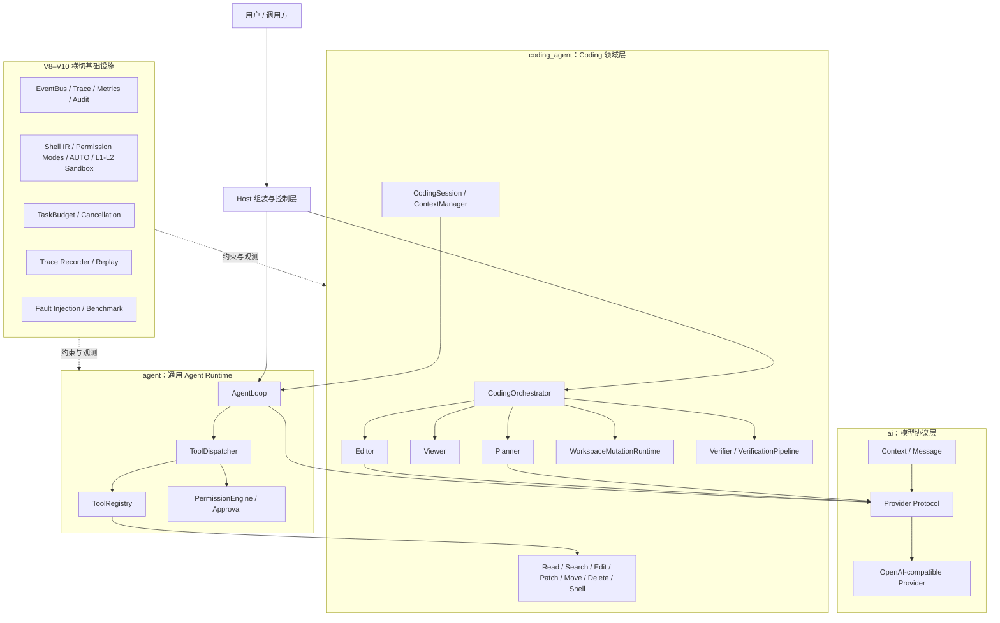
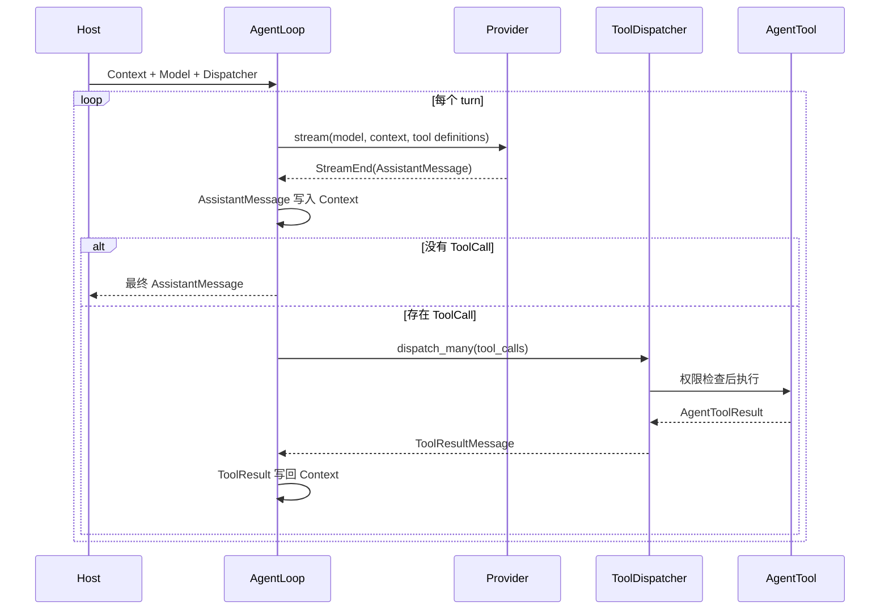
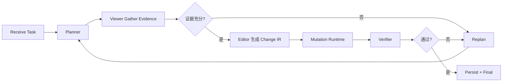
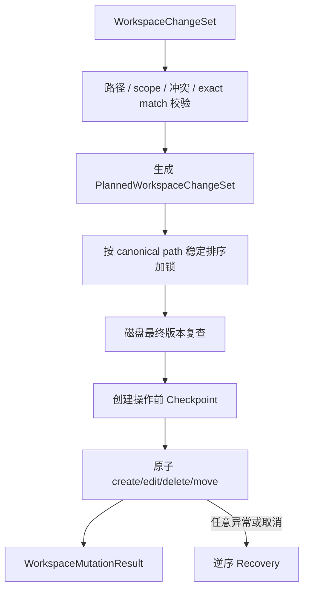

# Mini-Pi 项目架构总览

> 基于当前仓库实际代码整理，覆盖 V1–V11.1；持久化与恢复变化见第 25–26 节。  
> 更新时间：2026-10-15

## 1. 项目定位

Mini-Pi 是一个面向本地代码仓库的轻量 Coding Agent Runtime。它采用单模型架构，由 Host 掌握工具权限、文件版本、变更提交、验证、恢复、会话、预算和审计等关键控制权。

系统目前同时保留两条运行路径：

1. 通用 AgentLoop：模型可直接请求工具，适合 V1–V6 风格的交互式 Agent。
2. 分阶段 CodingOrchestrator：同一个模型依次承担 Planner 和 Editor，Host 执行 Viewer、Mutation、Verifier 与 Replan，构成 V7–V10 的主架构。

V8 增加可观测性、L1 本地约束、全局预算、Trace Replay、故障注入和离线 Benchmark。V9 将权限升级为双 Shell AST/IR、统一策略、五种权限模式和可审计审批；V10 增加默认关闭的语义 AUTO 模式、Docker/Podman L2 沙箱和 HTTP(S) 域名白名单。系统仍保持单 Agent、单模型，不引入 Multi-Agent、模型路由或向量数据库。

## 2. 总体架构



## 3. 分层与依赖

| 层 | 目录 | 职责 |
|---|---|---|
| 模型协议层 | `ai/` | 内部消息、上下文、模型描述、流式事件、工具定义、Provider 协议与 OpenAI-compatible 实现。 |
| 通用运行时层 | `agent/` | 最小模型循环、工具注册和调度、通用权限/审批协议、生命周期与预算 Hook。 |
| Coding 领域层 | `coding_agent/` | 文件系统、工具、变更 IR、恢复、会话、分阶段编排、验证、安全和 V8 工程能力。 |
| 验证层 | `tests/` | 单元、集成、安全、E2E、Replay、故障恢复和离线 Benchmark。 |
| 示例入口 | `demo.py`、`demo_v6.py`、`demo_v7.py` | 分别展示完整文件变更、可恢复会话、单模型阶段编排。 |

期望依赖方向为 `ai ← agent ← coding_agent`：底层协议不了解 Coding 领域。`agent/hooks.py` 保持了这种抽象边界；但当前 `agent/tool_dispatcher.py` 为序列化领域错误直接引用了 `coding_agent.errors`，这是现有的一处反向依赖技术债。

`coding_agent/cli.py`、`coding_agent/skills.py` 以及 `agent/agent.py`、`agent/events.py`、`agent/state.py` 当前仅为预留骨架，不是有效运行入口。

## 4. 两条核心运行链路

### 4.1 通用 AgentLoop

`agent/agent_loop.py` 保持最小的 `model ↔ tool` 循环：



关键性质：

- Provider 流必须自然消费到结束，确保网络流正确清理。
- Assistant 的 ToolCall 与随后 ToolResult 必须按协议完整写回上下文。
- 可注入 `AgentLoopObserver` 持久化每次上下文变化。
- 可注入共享 `AgentBudget` 限制 turn、模型调用、工具调用和总时长。
- 全为只读能力的同批工具调用可以并行；只要存在 mutation 或 execute，整批串行。
- 工具结果顺序始终与模型声明顺序一致。

### 4.2 Planner → Viewer → Editor → Verifier

`coding_agent/orchestration.py` 是当前更高层的任务状态机：



此链路的职责边界如下：

- Planner：只接收目标、约束、Repository Map、Session Summary 和诊断；不持有工具，也不能输出 patch。
- Viewer：确定性执行 glob/search/read，只收集有版本绑定的最小证据集。
- Editor：与 Planner 共用同一个 Provider 实例和 Model 实例；只输出结构化 `WorkspaceChangeSet`，不直接写文件。
- Mutation Runtime：Host 先把 Change IR 映射成无内容的 mutation capability/target 摘要，经统一权限与审批后再验证并提交。
- Verifier：Host 运行真实验证并产生 `VerificationDecision`。
- ReplanController：只有 Host 能决定重规划条件和 revision；模型不能自行提高 revision。
- CodingOrchestrator：统一推进状态、预算、会话状态、Trace、指标和最终成功语义。

默认阶段顺序是 `RECEIVE_TASK → PLAN → GATHER_EVIDENCE → EDIT → MUTATE → VERIFY → [REPLAN] → FINAL`。只有验证真实通过时，任务才会返回 `TaskOutcome.passed=true`。

## 5. AI 协议层

`ai/` 提供与具体 Agent 逻辑解耦的内部协议：

- `Context`：一个 system prompt 加有序消息列表。
- `UserMessage`、`AssistantMessage`、`ToolResultMessage`：内部消息联合类型。
- `ToolCall`：模型输出的工具名、调用 ID 和 JSON 参数。
- `Model`：模型 ID 与 Provider 标识。
- `ToolDefinition`：发送给模型的 JSON Schema 工具定义。
- `AIEvent`：`StreamStart`、`TextDelta`、`ToolCallReady`、`StreamEnd`、`StreamError`。
- `Provider`：只要求实现异步 `stream()`。
- `OpenAIProvider`：使用官方 `AsyncOpenAI` Chat Completions 流式接口，可通过 `base_url` 连接兼容服务。

Provider 会累积流式工具参数，并在流结束后严格解析成 JSON object。损坏的 JSON 参数会变成错误，不会被静默替换为空参数。

## 6. 工具体系

所有工具继承 `AgentTool`，通过 `name`、`description`、JSON Schema `parameters` 和 `capabilities` 描述自己，并返回 `AgentToolResult(content, details)`。

| 工具 | 能力 | 主要用途 | 默认权限 |
|---|---|---|---|
| `read` | `read_fs` | 读取 UTF-8 文件并返回版本快照 | allow |
| `glob` | `search_fs` | Workspace 内按模式列举文件 | allow |
| `search` | `search_fs` | 有界文本搜索与上下文行 | allow |
| `edit` | `write_fs`, `edit_file` | 单文件精确替换 | default: ask；accept_edits: allow |
| `write` | `write_fs`, `create_file` | 只创建不存在的新文件 | default: ask；accept_edits: allow |
| `patch` | `write_fs`, `edit_file`, `multi_file_edit` | 多文件 plan-then-apply 精确替换 | default: ask；accept_edits: allow |
| `move` | `write_fs`, `move_file` | 版本保护的移动/重命名 | ask |
| `delete` | `write_fs`, `delete_file` | 版本保护的删除 | ask |
| `powershell` | `execute` | Windows 测试、lint、build、检查 | AST/IR 策略；只读及已验证测试 allow，其余 ask/deny |
| `bash` | `execute` | POSIX Shell 执行路径 | 与 PowerShell 共用同一风险矩阵和沙箱协议 |

### 6.1 Registry 与 Dispatcher

`ToolRegistry` 保证工具名唯一，并导出 Provider 所需的工具定义。`ToolDispatcher` 的执行顺序为：

1. 消耗工具预算。
2. Registry 查找工具。
3. 发出 requested 生命周期事件。
4. PermissionEngine 返回 allow/ask/deny。
5. ask 时调用 ApprovalHandler；没有审批器则返回 `approval_required`。
6. 执行工具。
7. ToolResultObserver 更新 Host 观察状态。
8. 发出 completed/failed/denied 事件。
9. 将领域错误安全序列化成 `ToolResultMessage`。

意外异常只返回固定的 `internal` 错误，不向模型泄露 traceback、本机路径或内部实现信息。观察器和可观测性 Sink 失败不会改写工具的真实结果。

## 7. 文件系统与路径边界

`Workspace` 是所有模型输入路径进入磁盘前的统一边界：

- 只接受 Workspace-relative 路径。
- 拒绝空路径、NUL、绝对路径、Windows drive/UNC/device path。
- 拒绝 `CON`、`PRN`、`AUX`、`NUL`、`COM1..9`、`LPT1..9` 等保留设备名。
- 使用 `resolve(strict=False)` 解析已有 symlink/junction，再执行 `relative_to(root)` containment check。
- 对外统一使用 POSIX 风格相对路径。

文件数据层还包括：

- `FileSnapshot`：内容、编码、换行符、BOM 和 `FileVersion`。
- `FileVersion`：SHA-256、大小和可选 mtime；一致性判断以算法、digest 和大小为准。
- `atomic_write_*`：同目录临时文件、flush、fsync、原子 replace，并支持 replace 前最终版本复查。
- `decode_text_file` / `encode_text_file`：内部统一 LF，落盘时恢复 UTF-8 BOM 和 LF/CRLF。
- `FileMutationQueue`：按 canonical path 提供异步锁，防止同一路径的并发写冲突。
- `checked_delete` / `checked_move`：对删除和移动执行存在性、版本和目标状态保护。

## 8. Change IR、Mutation 与 Recovery

系统有两代兼容 IR：

- `ChangeSet`：V3 多文件精确文本替换结构。
- `WorkspaceChangeSet`：V5+ 的统一文件生命周期 IR，支持 `create_file`、`edit_file`、`delete_file`、`move_file`，单次最多 50 个操作。

主变更链路：



安全不变量：

- 所有操作先完整规划；规划失败时磁盘零改动。
- 同一 ChangeSet 内检测 edit/delete、delete/move、重复目标等冲突。
- exact replacement 必须唯一匹配、非空、非 no-op 且互不重叠。
- 真正落盘前重新读取磁盘版本，Observation 不能替代最终检查。
- 多路径锁按稳定顺序获取，避免死锁。
- 部分失败或取消时按已应用操作的逆序恢复。
- Recovery 也校验当前状态，不覆盖用户的外部修改、重新创建文件或已改变的 move 目标。
- Recovery 不完整时抛出 `WorkspaceRecoveryError`，包含 primary error 和逐操作 failure report。

`CheckpointStore` 当前是进程内存存储；Session 持久化不会自动重放未完成的 destructive mutation。

## 9. Observation 与版本所有权

`ObservationStore` 保存 Host 的 last-known 文件状态。Read、Create、Edit、Patch、Delete、Move、Rollback 和 Formatter 结果可以更新 Observation。

`VersionResolver` 将模型从“手工复制 hash”中解耦：

1. 模型先通过 read 获取文件。
2. ToolResultObserver 把版本写入 ObservationStore。
3. Edit/Delete/Move/Patch 从 Store 获取 expected version。
4. Mutation 落盘前再次检查真实磁盘。

Observation 只是缓存，不是事实来源。文件被外部修改后，最终 disk recheck 会返回 `stale_version`，要求重新读取和规划。

## 10. Session、恢复与上下文压缩

`CodingSession` 将通用 AgentLoop 包装成可持久化生命周期：

- `SessionState`：session ID、目标、状态、turn、压缩摘要、观察、metadata、interrupted 标记、当前计划 revision、权限模式、结构化安全约束和 AUTO block 计数。
- `SessionSnapshot`：纯数据状态加 Context，不包含 Provider、客户端、锁或 Workspace 等 runtime object。
- `SessionStore`：在 `.mini_pi` 风格目录下使用临时文件、fsync 和 `os.replace` 原子保存 JSON。
- `SessionPersistenceObserver`：每次上下文变化后保存，并在工具调用组完整时触发压缩。
- `CodingSession.resume()`：恢复 observation；如果发现不完整 ToolCall/ToolResult 组，只保留稳定前缀并要求先 read/search/verify 对账。
- 权限模式、`SafetyConstraints` 和 AUTO 降级计数独立于聊天历史持久化；压缩或恢复不会丢失“不要联网/删除/push”等明确约束。

Session 状态包括 `active`、`completed`、`failed`、`cancelled`。取消时会保存 cancelled/interrupted 状态，而不是把未完成调用标记为成功。

### 10.1 ContextManager

`ContextBudget` 控制模型输入窗口、保留输出空间和压缩阈值。`DeterministicCompactor`：

- 把 Assistant ToolCall 与对应 ToolResult 当作不可拆分原子组。
- 始终保留用户目标、最新完整组和可配置数量的近期组。
- 将已完成工作、当前状态、重要文件、验证状态、下一步及当前 Plan 汇总到 `<session_summary>`。
- 无法在硬限制内压缩时抛出 `context_budget_exceeded`，不会无界发送。

## 11. Repository Map 与 Viewer 证据边界

`RepositoryMapBuilder` 默认扫描最多 500 个 Python 文件，每个文件最多 1 MB，通过 AST 提取顶层 class、function 和 import，只保存导航元数据，不复制源码正文。

Viewer 的默认硬限制是：

- 最多 20 个文件。
- 最多 50 个 snippet。
- 总计最多 100,000 字符。
- 搜索结果默认携带前后 2 行。

Viewer 只允许 glob、search、read。每个 EvidenceSnippet 都绑定读取时的 FileVersion；无法定位、读取失败、截断或超限会进入 `unresolved_questions`，并由 Host 决定是否 Replan。

## 12. 验证与诊断

验证体系由以下部分组成：

- `CommandVerifier`：执行 Host 预定义命令，返回 exit code、stdout/stderr、耗时与诊断。
- `VerificationPipeline`：串行运行多个 verifier，可配置首错停止，统一聚合、排序、去重和限制诊断。
- `PytestParser`、`RuffParser`：把常见命令输出转换为结构化 Diagnostic。
- `Verifier`：比较 baseline diagnostics，只有底层验证通过且没有新增 ERROR 时才返回 passed。
- `FormatterRuntime`：formatter 产生的内容不会直接覆盖 Workspace，而会构造成 ChangeSet，再通过 PatchRuntime 提交。

`VerificationScope` 携带 changed files/ranges，为定向验证保留扩展接口；具体 verifier 可以选择是否使用。

## 13. V9–V10 权限、命令策略与沙箱

所有工具现在经过同一条决策链：

```text
ToolCall → capability/path normalization → Shell AST/IR（如适用）
         → deterministic rules → permission mode
         → approval or semantic AUTO（仅 ASK）→ sandbox → execute
```

### 13.1 双 Shell AST 与共享 IR

- PowerShell 由固定桥接程序调用官方 `Parser.ParseInput`。待分析命令只经 stdin 的 Base64 帧输入，桥接程序不执行命令。
- Bash 使用 `tree-sitter` 与 `tree-sitter-bash` 构造相同的 `ShellParseResult`。
- IR 记录 executable、argv、环境赋值、包装器、复合操作符、嵌套深度、重定向、源码范围和 dynamic 标记。
- PowerShell 内置别名会规范化；Bash 的 `env/time/timeout/nice/nohup/command/builtin` 等包装器会展开。
- `&&`、`||`、`;`、管道、后台任务、子 Shell、命令替换和重定向分别产生节点，最终执行 `DENY > ASK > ALLOW`。
- 动态命令、未知命令、解析失败以及 `python -c`、`node -e`、`bash -c` 等任意代码入口默认 ASK。
- Shell 删除/移动、`Invoke-Expression`、`EncodedCommand`、`git reset --hard`、强制 clean/force push 属于不可审批覆盖的硬 DENY。

`CommandRisk` 与 `CommandPolicy` 保留兼容接口，但判定来源已是 AST/IR，不再扫描整串命令正则。PowerShell 与 Bash 工具内部仍保留共享硬拒绝守卫，避免绕过 Dispatcher 直接调用。

V7–V10 Planner→Editor 主链路生成的 `WorkspaceChangeSet` 也会在 Host apply 前进入相同 PermissionEngine；不会因绕过 ToolDispatcher 而绕过 `plan/default/accept_edits/auto`。

### 13.2 规则、模式与审批

设置按以下顺序分层：

```text
built-in < ~/.mini_pi/settings.json < <workspace>/.mini_pi/settings.json < session override
```

标量后层覆盖前层；规则按 ID 合并，同 ID 不同内容直接报配置错误。命令规则匹配规范化 argv token，只允许最后一个 token 是 `*`。冲突始终按 DENY、ASK、ALLOW 的优先级合并。

| 模式 | 行为 |
|---|---|
| `default` | read/search 与参数已验证的 build/test 自动允许；文件 mutation、网络、安装、opaque/unknown 询问 |
| `accept_edits` | 在 default 上额外允许 workspace 内 create/edit/patch；move/delete/Shell 仍按策略 |
| `plan` | 只允许 glob/search/read；mutation 与 Shell 拒绝 |
| `auto` | 只有 deterministic ASK 可进入 V10 分类器；分类器关闭时退化为 default |
| `dont_ask` | 把所有 ASK 转成 DENY，适合非交互运行 |

审批结果为 `APPROVE_ONCE`、`APPROVE_SESSION` 或 `DENY`。旧 `APPROVE` 是一次性批准的兼容别名。本会话批准使用 workspace 指纹并绑定工具、capability 与精确命令哈希或规范化目标，不能覆盖硬 DENY，也不能跨 workspace 复用。

### 13.3 V10 Semantic AUTO

AUTO 默认关闭，并且只接收 deterministic ASK。分类器先要求单标记 `ALLOW/BLOCK`；除明确 ALLOW 外，再做一次严格 JSON 复核。超时、Provider 错误、非法输出都回到人工 ASK，确定性 DENY 永远不会调用分类器。

分类输入仅含脱敏后的规范化操作、用户要求、持久化 `SafetyConstraints`、近期非只读摘要、workspace 相对目标和有界 git 状态。解释器代码体、凭据参数、URL 查询、环境变量、工具输出与源码全文不会进入请求。分类器调用次数、结果、延迟和估算 token 独立计量。

连续 BLOCK 3 次或累计 BLOCK 20 次后自动切回 default。AUTO 会忽略 Shell 全局通配、解释器通配和包管理器脚本通配等宽泛 allow 规则。AUTO 对不能由确定性规则证明安全的 Shell 默认要求可预检的 L2；不可用时回退人工 ASK，而不是自动在 L1 执行。

### 13.4 L1 与 L2

L1 `LocalSandbox` 仍是默认运行环境：固定 cwd、环境 allowlist、secret key 排除、有界输出、timeout/cancel 进程树终止。它明确声明 `strong_isolation=false`、`network_isolated=false`，不是安全边界。

L2 `ContainerSandbox` 支持 Docker/Podman：

- `engine=auto` 依次探测 Docker、Podman；显式 L2 不可用时失败关闭，不降级 L1。
- 镜像必须使用 64 位 SHA-256 digest 固定；执行前检查本地镜像。
- 非 root、只读 rootfs、`cap-drop ALL`、`no-new-privileges`、PID/CPU/内存/输出/时间限制。
- 只挂载 workspace；`.git` 叠加只读挂载；`/tmp` 使用 noexec/nosuid tmpfs；不挂载 host socket。
- 默认 `network=none`。allowlist 模式下工作容器只连内部网络，双网络代理是唯一出口。
- 代理只支持 HTTP 和 HTTPS CONNECT 的 80/443 端口；拒绝直接 IP、私有/保留解析结果、未授权域名和二次 DNS 重绑定，并规范化 HTTP Host。

L2 的真实 Docker/Podman 与联网验证是 opt-in CI 测试；普通离线测试只验证参数、失败关闭和策略不变量。

## 14. TaskBudget 与 Cancellation

`TaskBudget` 默认值：

| 项目 | 默认上限 |
|---|---:|
| turns | 30 |
| model calls | 20 |
| tool calls | 100 |
| replans | 3 |
| duration | 300 秒 |

`BudgetTracker.run()` 用剩余总时长包装异步操作；耗尽后抛出结构化 `BUDGET_EXHAUSTED`。CodingOrchestrator 将同一 Tracker 传播给 Planner、Viewer、Editor、Mutation 和 Verifier。通用 AgentLoop 也提供可选 AgentBudget 注入，并把它继续绑定给 ToolDispatcher。

取消会继续传播到模型请求、并行 read、审批等待、工具、进程和验证。Mutation Runtime 捕获包括 `CancelledError` 在内的中断，在已进入临界区时先 Recovery，再重新抛出取消。

## 15. 可观测性与审计

V8 可观测性采用事件驱动设计：

- `AgentEvent`：event/session/trace/span/parent span、UTC 时间、类型和安全 payload。
- `EventBus`：在锁内按注册顺序 fan-out；普通 Sink 异常只计数和记录，不改变领域结果。
- `TraceContext`：创建 root trace 和 child span。
- `ToolEventObserver`、`MutationEventObserver`：把运行时 Hook 转换为 AgentEvent。
- `MetricsSink`：按 trace 聚合模型、token、工具、mutation、验证、replan、rollback、timeout、权限和安全指标。
- `ArtifactStore`：SHA-256 content-addressed、去重、原子写入，ArtifactRef 仅暴露 store-relative path。
- `AuditSink`：把批准/拒绝、命中规则、mutation、rollback 和 sandbox violation 记录为脱敏 JSONL。

V9–V10 新增 policy evaluation、approval requested/resolved、AUTO classification 和 L2/network violation 事件。Metrics 额外统计 parser fallback、allow/ask/deny、审批打断、分类结果/延迟/估算 token、AUTO 降级、L2 启动失败和网络拦截。

所有事件进入 Sink 前都会递归脱敏。权限审计使用字段白名单，只保存命令 SHA-256、脱敏规范化操作、workspace 相对目标、规则、风险和决策，不保存原始命令或参数。默认不记录完整 prompt、完整环境、无限 shell 输出或任意大型文件。常见 secret key、`sk-...`、Bearer token 和环境变量形式会被替换为 `[REDACTED]`。

主要事件覆盖 task、plan、model request、tool、mutation、rollback、verification、context compaction、session 和 sandbox 生命周期。

## 16. Trace Recorder 与 Replay

`TraceRecorder` 同时是 EventSink，记录脱敏事件、RunMetrics、ArtifactRef、确定性工具动作和验证摘要，并支持原子保存 JSON。

`TraceReplayer` 的约束：

1. 不调用模型。
2. 解析并 hash 源 fixture。
3. 复制到系统 `TemporaryDirectory`。
4. 在副本中构造真实 Workspace。
5. 用真实 FileVersion 和 WorkspaceMutationRuntime 逐个重放 recorded mutation action。
6. 可运行调用方提供的 verifier。
7. 比较 replay 后状态，并再次确认源 fixture hash 未改变。

第一版 Replay 仅支持 `workspace_mutation` tool-level action。版本分歧会触发 stale error 并立即停止；不会直接把 recorded final file 覆盖到磁盘。

## 17. Fault Injection

生产使用 `NoopFaultInjector`，测试使用按命名点和调用次数触发的 `ScriptedFaultInjector`。当前注入点包括：

- `before_atomic_replace`
- `after_first_file_write`
- `before_second_file_write`
- `checkpoint_create_failure`
- `rollback_failure`
- `session_save_failure`
- `process_timeout`
- `event_sink_failure`（通过失败 Sink）
- `verification_failure`

这些点用于验证原文件不被半写、部分多文件变更可逆序恢复、恢复失败可报告、Session 不发布半成品，以及观测故障不污染领域结果。

## 18. 离线 Benchmark

`BenchmarkRunner` 的任务流程为：

```text
load BenchmarkTask
→ 校验 fixture 位于 fixtures_root
→ copy 到临时 Workspace
→ 运行注入的 deterministic executor
→ Host acceptance
→ forbidden path / expected changed files 检查
→ 收集 metrics 与 trace
→ 清理临时目录
```

Host acceptance 只接受被分类为 READ_ONLY 或 BUILD_TEST 的命令。安全违规、forbidden path 改变或 changed-files 不符都会压过 executor 的成功声明。

报告支持：

- JSON：结构化 summary 和逐任务结果。
- CSV：逐任务指标。
- Markdown：Correctness、Safety、Efficiency、V8/V9/V10 profile 对比和 Recovery。

每个 Benchmark 结果可标记 profile，并报告安全违规率、审批次数、自动允许/阻止率、分类器调用与估算 token 成本、解析降级、沙箱违规和任务成功率。Fake/离线结果与 opt-in 真实模型结果必须使用不同 profile 或运行批次，不混合解释。

当前 fixture 集有 13 类任务，覆盖单文件、多文件、创建、移动、删除、验证修复、STALE、NO_MATCH、部分恢复、权限拒绝、危险 shell、长上下文和 Session Resume。它是离线确定性层；真实模型测试仍为 opt-in。

## 19. 结构化错误模型

所有可预期领域错误继承 `CodingAgentError`，具有：

- 稳定 `ErrorCode`
- 可展示 message
- `retryable`
- 结构化 details
- 可选 suggested action

主要类别包括路径逃逸、参数错误、文件不存在/已存在、STALE、NO_MATCH、AMBIGUOUS_MATCH、重叠/no-op edit、权限/审批、进程 timeout/start failure、patch/workspace recovery failure、未观察文件、Session 持久化、上下文预算、Session 对账、Planner/Editor/Replan、CommandPolicy block 和 TaskBudget exhaustion。

Dispatcher 只把这种安全结构发送给模型；未知异常统一降级为不含内部细节的 `internal`。

## 20. 目录职责速查

```text
mini-pi/
├─ ai/                         模型、消息、Provider 协议
├─ agent/                      AgentLoop、工具注册/调度、权限 Hook
├─ coding_agent/
│  ├─ agents/                 Planner / Viewer / Editor / Verifier
│  ├─ benchmark/              离线基准、结果与报告
│  ├─ changes/                Change IR、diff、range、checkpoint、rollback
│  ├─ diagnostics/            结构化诊断
│  ├─ editing/                exact edit 与旧 PatchRuntime
│  ├─ filesystem/             Workspace、版本、快照、原子 IO、锁
│  ├─ mutation/               Workspace ChangeSet planner/runtime/recovery
│  ├─ observability/          events、bus、trace、metrics、artifact、audit
│  ├─ process/                shell 配置、进程执行、进程树终止
│  ├─ replay/                 TraceRecord、Recorder、Replay
│  ├─ safety/                 Shell IR/解析、统一策略、权限模式、AUTO、审批
│  ├─ sandbox/                L1 LocalSandbox、L2 ContainerSandbox、egress proxy
│  ├─ search/                 glob 与文本搜索 runtime
│  ├─ testing/                fault injection
│  ├─ tools/                  Coding Agent 工具适配器
│  ├─ verification/           verifier、parser、pipeline、formatter
│  ├─ web/                    FastAPI、SSE、目录/Provider/Task/审批适配层
│  ├─ orchestration.py        V7/V8 主阶段状态机
│  ├─ session.py              Session 生命周期与中断对账
│  ├─ session_store.py        原子 JSON 持久化
│  ├─ observations.py         Host last-known file state
│  ├─ compaction.py           确定性上下文压缩
│  ├─ context_manager.py      上下文预算执行
│  ├─ repository_map.py       Python AST 导航图
│  └─ task_budget.py          全任务资源预算
├─ tests/
│  ├─ observability/          Event/Trace/Metric/Artifact/Audit 测试
│  ├─ security/               路径、命令、沙箱与 Secret 测试
│  ├─ e2e/                    V8 生产路径 E2E
│  ├─ web/                    Workbench API、安全边界和 Fake Provider E2E
│  └─ fixtures/               V7 task set 与 V8 benchmark repos/tasks
├─ web/                       React/Vite/TypeScript 工作台与 Playwright 测试
├─ demo.py                    V5 工具闭环示例
├─ demo_v6.py                 Session/Resume 示例
├─ demo_v7.py                 分阶段 Orchestrator 示例
└─ V6/V7/V8/V9_V10_AUDIT_REPORT.md   每轮迭代审计记录
```

## 21. 配置与运行方式

项目要求 Python 3.11+，主要运行依赖为 Pydantic、OpenAI SDK、tree-sitter Bash、FastAPI 和 Uvicorn；Web 前端使用 React、Vite 与 TypeScript，测试使用 pytest/pytest-asyncio、Vitest 和 Playwright。当前 `pyproject.toml` 将项目标记为应用而非可安装包，通常通过 `uv run` 从仓库根目录执行。

常用命令：

```powershell
# 全量测试
uv run python -m pytest -q

# V6 会话模式；需要 DEEPSEEK_API_KEY
uv run python demo_v6.py

# V7 分阶段模式；还必须显式指定目标仓库
$env:MINI_PI_V7_WORKSPACE = "E:\path\to\repo"
uv run python demo_v7.py
```

`OpenAIProvider` 支持自定义 `base_url`，因此示例可连接 DeepSeek 等 OpenAI-compatible 服务。生产调用应显式组装 Workspace、共享的 MutationQueue/CheckpointStore、权限与审批器、验证器、EventBus/Sinks、TaskBudget 和 TraceRecorder。

## 22. Web Workbench

`coding_agent/web/` 将现有单模型编排安全地适配为本机 FastAPI 服务，`web/` 提供 React/Vite/TypeScript 单页工作台。浏览器通过 REST 创建、取消和恢复任务，通过 SSE 接收脱敏 `AgentEvent`；服务端 `WebApprovalHandler` 用 Future 暂停执行，Mutation Preview 则在权限审批前通过只读 planning 生成。

页面采用浅色三栏布局，展示 Session、任务输入、Planner→Viewer→Editor→Verifier 阶段、结构化计划、统一 Diff、验证诊断和实时安全事件。低于 1200px 时事件栏变为抽屉，移动端收敛为单栏。

工作台仅监听 loopback。目录选择受启动时 allowed roots 约束，Provider base URL 与 API Key 环境变量由服务端配置固定，浏览器只能选择允许的 Provider/Model。CSRF、Host/Origin、canonical path、symlink、单活动任务和过期审批均在后端强制执行；网页不能覆盖 V9/V10 的确定性硬拒绝。

具体启动、配置和验收命令见 `WEB_WORKBENCH.md`。

## 23. 测试现状

包含 Web Workbench 的最终完整回归使用 `uv run python -m pytest -q`：814 collected、803 passed、0 failed、11 skipped。skipped 包括四个付费真实模型 smoke test、六个 Docker/Podman L2 opt-in 集成项，以及当前 Windows 环境无法创建目录 symlink 的一个平台条件测试。其余覆盖包括：

- AI 消息与 OpenAI Provider 流式转换。
- AgentLoop、Dispatcher、权限和并行调度。
- Workspace 路径与 Windows 特殊路径。
- Exact edit、Change IR、Patch、Create/Delete/Move。
- 版本冲突、Checkpoint、Rollback 与多文件 Recovery。
- Process timeout、输出截断和进程树取消。
- Diagnostic、Verifier、Parser、Formatter。
- Session、Compaction、Resume 和 interrupted reconciliation。
- Planner、Viewer、Editor、Verifier、Replan 与 V7 E2E。
- Event、Trace、Metric、Artifact、Audit 和 Secret isolation。
- TaskBudget、Cancellation、Fault Injection、Replay 和 13-task Benchmark。
- PowerShell/Bash AST、250 个双 Shell 对抗样例、五种权限模式和规则冲突。
- AUTO Fake Provider 的 allow/block/timeout/损坏输出/prompt injection/恢复边界。
- L2 参数、固定镜像、失败关闭、资源限制与网络 allowlist；真实引擎测试由 opt-in CI 执行。
- Workbench allowed-root、Provider secret isolation、CSRF/Host/Origin、SSE、审批、Diff Preview、单任务取消及真实 Fake Provider→pytest 闭环。
- React TypeScript/ESLint、4 个 Vitest 组件测试、生产构建、2 个 Edge Playwright E2E 和桌面/移动视觉快照。

## 24. 当前边界与技术债

- LocalSandbox 只是 L1 进程约束，不隔离网络，也不是 OS/container 安全边界。
- L2 依赖调用方预装 digest-pinned、同时含目标 Shell 与 Python 的镜像；当前本机离线回归不等于真实 Docker/Podman 验收。
- Semantic AUTO 默认关闭；token 成本为确定性估算，不代表 Provider 账单，真实模型效果需独立 opt-in 评测。
- AST/IR 能可靠处理已建模语法，但未知命令、动态表达式和解析错误仍保守 ASK，而不是宣称可证明安全。
- Trace Replay 仅支持记录的 WorkspaceMutation action，不重放模型生成或任意工具。
- 旧 CheckpointStore 保留内存兼容实现；V11 主入口使用独立 MutationJournal 和私有恢复材料，不能把旧内存实现当作跨进程日志。
- Repository Map 目前只解析 Python 顶层 AST 符号。
- CLI 和 Skills 模块仍是骨架；当前主要入口是 demo 或代码组装。
- `agent.tool_dispatcher` 对 `coding_agent.errors` 存在反向依赖。
- Benchmark fixture 数量有限，离线 executor 不能替代真实模型质量评估。
- 没有 Multi-Agent、模型路由、向量检索、云端多租户或远程执行。

## 24. 推荐扩展点

在不破坏现有边界的情况下，可按以下接口扩展：

- 新模型后端：实现 `Provider.stream()`。
- 新工具：继承 `AgentTool`，声明精确 capability，并注册到 ToolRegistry。
- 新权限策略：实现 `PermissionEngine.evaluate()`。
- 新审批界面：实现 `ApprovalHandler.request()`。
- 新观测出口：实现 `EventSink.emit()` 并挂到 EventBus。
- 新验证器：实现 verification `Verifier` protocol；可附加 DiagnosticParser。
- 新沙箱：实现 `Sandbox.start()` / `SandboxSession.run()`，并准确声明 ResourcePolicy。
- 新持久化：保持 SessionSnapshot 为纯数据，并提供与 SessionStore 等价的原子边界。
- 新 Benchmark Agent：实现 `BenchmarkExecutor` 回调，但仍让 Runner 管理临时 Workspace、Host acceptance 和安全判定。

新增 mutation 类型时，必须同步扩展 IR 校验、Planner、Runtime、Checkpoint/Recovery、Observation、Trace Replay、权限与故障测试，不能绕过统一变更管线直接写最终文件。

## 25. V11 统一运行内核

V11 主路径为 `Web / SDK / demo_v7 → build_coding_runtime → RuntimeKernel.execute → CodingOrchestrator`。通用 AgentLoop 与旧构造函数仍兼容，不能据此声称任意工具已具备安全重放能力。

新增 `coding_agent/runtime/`：

| 模块 | 职责 |
| --- | --- |
| models / transitions | Session 关联的 Run、Step、Operation、审批与合法状态转换 |
| kernel / factory | 单写者、单 executor、公共生命周期和统一依赖装配 |
| store / session_store / privacy | SQLite 状态、事务事件、私有恢复 blob、JSON 兼容导入与权限 |
| journal | 写前意图、文件前后状态、部分批次补偿和恢复过程再次中断 |
| approvals | 有效期、Proposal/策略/版本绑定、受限 Session grant 与一次性授权恢复 |
| acceptance | Host 冻结 Contract、注册检查、范围与不变量、逐项证据和人工确认 |
| budgets | 持久化配额预占与活动时间，恢复不得获得新预算 |

RuntimeStore 是 V11 会话与运行状态的事实来源，JSON 仅保留旧实现、导入与历史用途。运行事件先持久化再通知观察者；Web 的 TaskRecord 是传输及进程内资源适配器，不承担独立执行事实。

恢复只在可证明的文件状态上继续。硬 DENY、当前策略、路径边界和版本检查仍优先；未知文件状态或验证副作用进入 `needs_reconciliation`。文件系统与数据库不构成跨文件 ACID 事务，也不承诺 arbitrary Shell exactly-once。

Acceptance Contract 与 Plan 分离。模型可以修改业务计划，但不能降低 Host 验收要求。最终成功必须有当前代码/策略/Contract 对应的证据，且不存在未完成操作或待确认条件；默认检查通过只代表注册检查覆盖范围。

Web 支持持久化审批、重启后的预览重建、事件重放、显式恢复及只读对账报告。Diff 和原始恢复字节不进入审计事件。启动、兼容迁移、测试矩阵和已知边界详见 `WEB_WORKBENCH.md` 第 7 节。

## 26. V11.1 恢复对账、维护与发布门禁

`runtime/recovery.py` 从持久化验证上下文、当前源码/策略/契约及进程租约生成只读评估；`RuntimeKernel.reconcile` 以 revision CAS 接收安全重试验证或保留修改结束任务。授权与最终执行各自检查条件，旧协议的未知副作用不获得新的重放权限。

Windows 验证采用 `process/owned_worker.py` 固定 stdin 门：先绑定命名 Job 并提交租约，再启动真实 Shell。重启时只使用 OS Job 停止证明，不猜测 PID；POSIX 硬崩溃及不确定 L2 租约继续失败关闭。Web 的 recovery 动作与 SSE 续接沿用原有同源、CSRF 和单任务限制。

`runtime/maintenance.py` 与 `python -m coding_agent.runtime` 提供完整性检查、私有备份、全新目录恢复、保留计划、备份后清理及压缩。未解决恢复材料受保护；容量目标无法达成时报告而非强删。半恢复标记防止中断恢复被误识别为空数据库。

SQLite 协议 2 为旧写者设置栅栏，事务迁移 schema 1 而不重写原数据；未来版本拒绝。CI 分离离线矩阵、真实 HTTP/重启、视觉/布局和 opt-in L2 门禁。操作示例、迁移边界与实测结果见 `WEB_WORKBENCH.md` 第 8 节。
